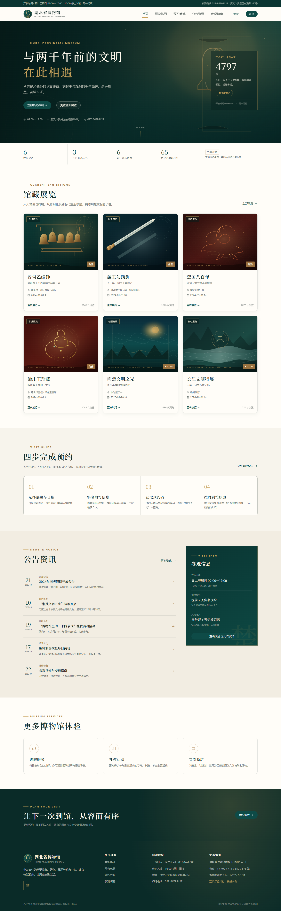
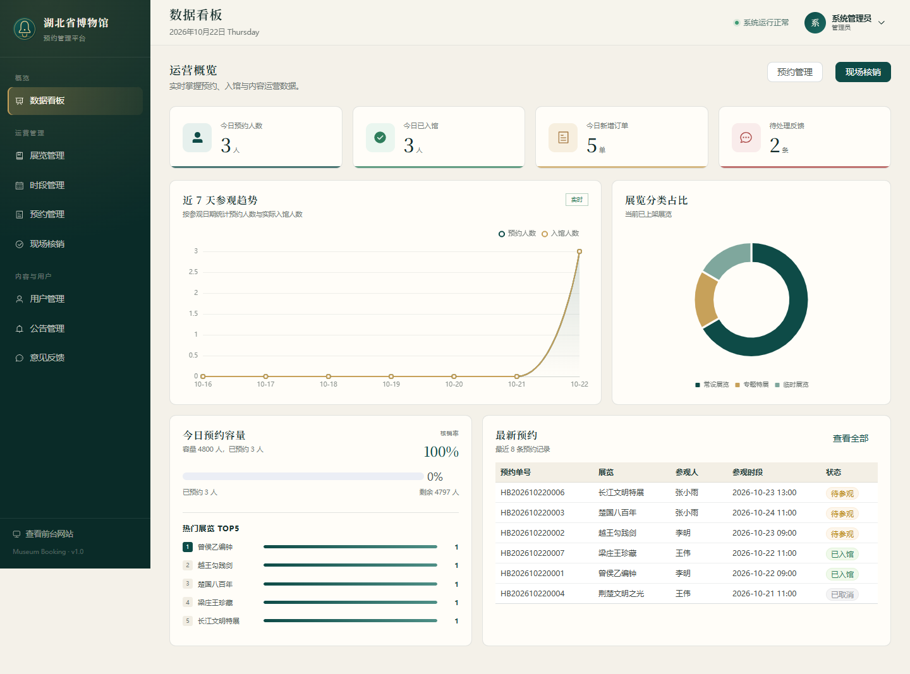
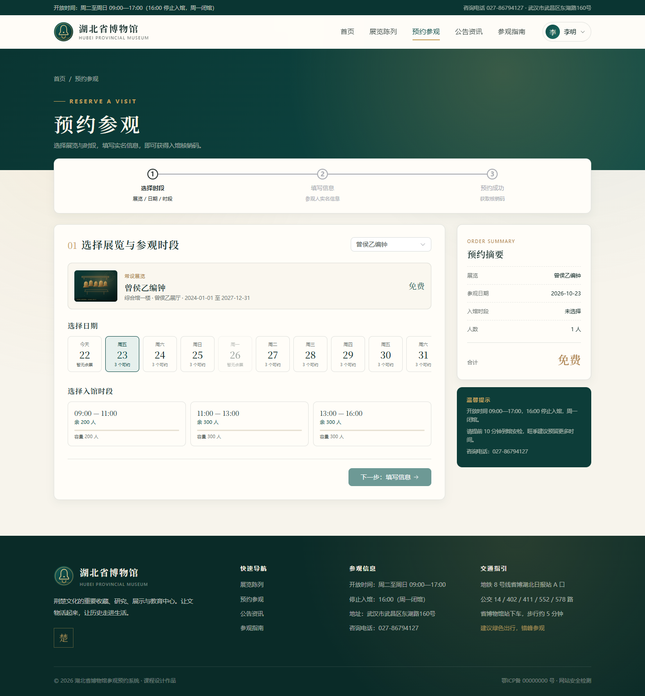
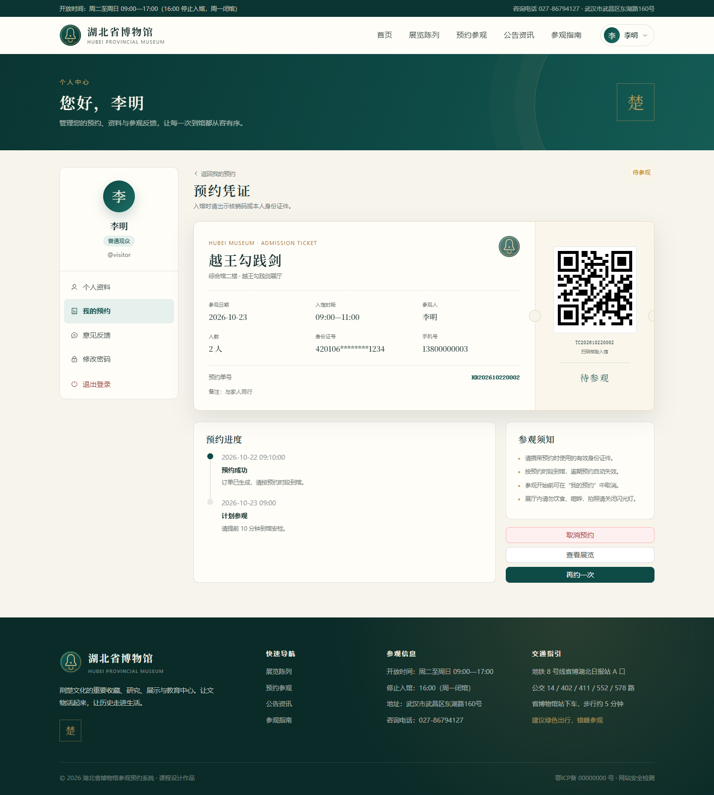

# 湖北省博物馆参观预约系统

> 计算机软件综合开发实训作品
>
> Vue 3 + TypeScript + Element Plus + Spring Boot 3 + MyBatis-Plus + MySQL

一个前后端分离的博物馆参观预约系统：观众可浏览展览、选择日期与入馆时段、实名预约、查看电子核销码、取消预约和提交反馈；管理员可维护展览与时段、管理预约与用户、发布公告、回复反馈并查看看板；检票员可现场核销入馆。

## 快速开始

### 1. 数据库（MySQL 3306）

确保本机 MySQL 3306 已启动，然后导入：

```bash
mysql -uroot -p < database/schema.sql
mysql -uroot -p < database/data.sql
```

`schema.sql` 会创建数据库 `museum_booking` 和应用账号 `museum / museum123`。

### 2. 后端

```bash
cd backend/booking
mvn spring-boot:run
```

后端地址：`http://127.0.0.1:8080`

### 3. 前端

```bash
cd frontend
npm install
npm run dev
```

前端地址：`http://127.0.0.1:5173`

### 4. 演示账号

| 角色   | 账号        | 密码            | 入口     |
| ------ | ----------- | --------------- | -------- |
| 观众   | `visitor` | `Visitor@123` | 前台     |
| 管理员 | `admin`   | `Admin@123`   | 管理后台 |
| 检票员 | `staff`   | `Staff@123`   | 现场核销 |

> 演示账号仅用于课程验收；部署前请修改密码与 `JWT_SECRET`。

## 功能

### 观众端

- 首页：推荐展览、今日余票、开放信息、公告、预约流程
- 展览：分类筛选、关键词搜索、详情、未来 7 天时段余量
- 预约：三步流程、实名信息、1—5 人、预约凭证
- 个人中心：资料、我的预约、二维码核销码、取消、反馈、改密
- 公告：分类、搜索、详情

### 管理端

- 数据看板：今日预约/入馆/核销率、7 天趋势、分类占比、热门展览
- 展览管理：CRUD、上下架、封面、展期、票价
- 时段管理：单条/批量生成、容量、开放关闭、删除保护
- 预约管理：多条件检索、详情、核销、取消、CSV 导出
- 现场核销：单号/核销码查询、预览、确认入馆、今日待核销
- 用户管理：启禁用、创建工作人员、重置密码
- 公告管理：草稿/发布/置顶
- 意见反馈：查询、回复

## 技术栈

| 层     | 技术                                                                                                  |
| ------ | ----------------------------------------------------------------------------------------------------- |
| 前端   | Vue 3.5、TypeScript 6、Vite 8、Element Plus 2.14、Pinia 4、Vue Router 5、Axios、ECharts 6、qrcode.vue |
| 后端   | Spring Boot 3.5、MyBatis-Plus 3.5、JWT (jjwt)、BCrypt、Jakarta Validation、Lombok                     |
| 数据库 | MySQL 8/9、utf8mb4                                                                                    |
| 测试   | JUnit 5、Mockito、Node fetch、Playwright Core                                                         |

## 目录结构

```text
museum/
├─ backend/booking/          Spring Boot 后端（63 个 Java 文件）
├─ frontend/                 Vue 前端（24 个页面、35 个 Vue 文件）
│  └─ scripts/               API 冒烟、并发测试、Playwright 截图脚本
├─ database/                 schema.sql、data.sql
├─ docs/                     系统说明.md + 截图
├─ 课程资料/                 课程发放材料
└─ README.md
```

## 截图

| 首页                                  | 管理看板                                         |
| ------------------------------------- | ------------------------------------------------ |
|  |  |

| 预约                                     | 凭证                                                |
| ---------------------------------------- | --------------------------------------------------- |
|  |  |
