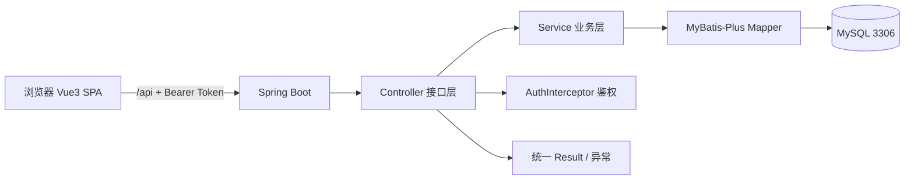
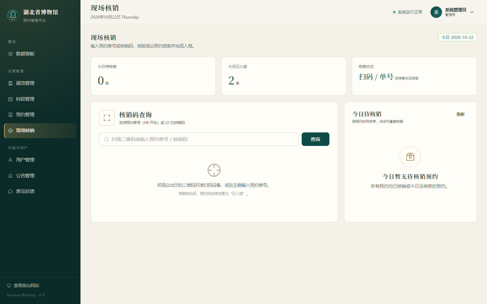

# 湖北省博物馆参观预约系统 · 系统说明

## 1. 这是什么

一个前后端分离的博物馆实名预约系统。

核心链路：

```text
观众选展览/日期/时段 → 实名预约 → 生成核销码 → 现场核销入馆
                                    ↘ 取消预约 → 释放库存
管理员：维护展览和时段、看数据、管预约、发公告、回反馈
```

## 2. 三种角色

| 角色 | 能做什么 | 账号 |
| --- | --- | --- |
| 观众 VISITOR | 浏览、预约、取消、看凭证、反馈、改资料 | `visitor / Visitor@123` |
| 检票员 STAFF | 查预约、核销入馆、看今日待核销 | `staff / Staff@123` |
| 管理员 ADMIN | 看板、展览、时段、预约、核销、用户、公告、反馈 | `admin / Admin@123` |

## 3. 技术栈

| 层 | 技术 |
| --- | --- |
| 前端 | Vue 3 + TypeScript + Vite + Element Plus + Pinia + Vue Router |
| 图表/二维码 | ECharts + qrcode.vue |
| 后端 | Spring Boot 3.5 + MyBatis-Plus 3.5 |
| 认证 | JWT + BCrypt + 拦截器 + 方法级角色 |
| 数据库 | MySQL 3306，库名 `museum_booking` |
| 测试 | JUnit 5 + Mockito + Node fetch + Playwright |

## 4. 总体架构



前端开发时 Vite 把 `/api` 代理到 `127.0.0.1:8080`。

## 5. 功能地图

| 端 | 页面/功能 |
| --- | --- |
| 公众端 | 首页、展览列表/详情、公告、参观指南、登录注册 |
| 个人中心 | 个人资料、我的预约、预约凭证/二维码、意见反馈、修改密码 |
| 预约 | 选展览 → 选日期/时段 → 填实名信息 → 成功页 → 我的预约 |
| 管理端 | 数据看板、展览管理、时段管理、预约管理、现场核销、用户管理、公告管理、反馈管理 |
| 检票端 | 单号/核销码查询 → 预约预览 → 确认核销 → 今日待核销 |

## 6. 关键代码在哪

| 想看什么 | 文件 |
| --- | --- |
| 预约核心（下单/取消/核销） | [ReservationService.java](../backend/booking/src/main/java/com/museum/booking/service/ReservationService.java) |
| 库存原子扣减 SQL | [VisitSlotMapper.java](../backend/booking/src/main/java/com/museum/booking/mapper/VisitSlotMapper.java) |
| 登录与 JWT | [AuthService.java](../backend/booking/src/main/java/com/museum/booking/service/AuthService.java)、[AuthInterceptor.java](../backend/booking/src/main/java/com/museum/booking/security/AuthInterceptor.java) |
| 展览/时段 | [ExhibitionService.java](../backend/booking/src/main/java/com/museum/booking/service/ExhibitionService.java)、[SlotService.java](../backend/booking/src/main/java/com/museum/booking/service/SlotService.java) |
| 管理看板 | [DashboardService.java](../backend/booking/src/main/java/com/museum/booking/service/DashboardService.java) |
| 预约页面 | [BookingView.vue](../frontend/src/views/public/BookingView.vue) |
| 现场核销页 | [AdminCheckinView.vue](../frontend/src/views/admin/AdminCheckinView.vue) |
| 管理看板页 | [DashboardView.vue](../frontend/src/views/admin/DashboardView.vue) |
| 路由与权限 | [router/index.ts](../frontend/src/router/index.ts) |
| 数据库脚本 | [schema.sql](../database/schema.sql)、[data.sql](../database/data.sql) |
| 后端配置 | [application.yml](../backend/booking/src/main/resources/application.yml) |

## 7. 数据库 6 张表

| 表 | 作用 | 关键字段 |
| --- | --- | --- |
| `sys_user` | 用户 | `username`、`password`(BCrypt)、`role`、`status` |
| `exhibition` | 展览 | `title`、`start_date/end_date`、`ticket_price`、`status` |
| `visit_slot` | 时段库存 | `exhibition_id`、`visit_date`、`start_time`、`capacity`、`booked_count`、`status` |
| `reservation` | 预约订单 | `order_no`、`user_id`、`slot_id`、`ticket_count`、`status`、`ticket_code` |
| `announcement` | 公告 | `title`、`content`、`category`、`is_top`、`status` |
| `feedback` | 反馈 | `user_id`、`type`、`content`、`reply`、`status` |

关系：

```text
sys_user 1 ── N reservation N ── 1 visit_slot N ── 1 exhibition
sys_user 1 ── N feedback
```

状态：

```text
预约：CONFIRMED 待参观 → CHECKED_IN 已入馆
                       ↘ CANCELLED 已取消
                       ↘ EXPIRED 已过期

展览：DRAFT 草稿 / PUBLISHED 上架 / CLOSED 下架
时段：OPEN 开放 / CLOSED 关闭
```

## 8. 核心流程

### 8.1 预约

1. 观众选时段并提交 `slotId`、参观人、人数。
2. 后端校验：时段开放、展览已上架、未过截止时间、无重复预约。
3. 用一条 SQL 原子扣库存。
4. 扣减成功才插入订单，生成 `orderNo` 和 `ticketCode`。
5. 返回预约凭证，前端展示二维码。
6. 任一步失败，事务回滚，库存不会少。

防超卖的关键 SQL（[VisitSlotMapper.java](../backend/booking/src/main/java/com/museum/booking/mapper/VisitSlotMapper.java)）：

```sql
UPDATE visit_slot
SET booked_count = booked_count + #{count}
WHERE id = #{slotId}
  AND status = 'OPEN'
  AND booked_count + #{count} <= capacity;
```

只有影响行数 = 1 才算预约成功；否则提示余票不足。

### 8.2 取消

1. 只能取消自己的 `CONFIRMED` 订单（管理员除外）。
2. 参观开始前才能取消。
3. 条件更新 `status='CANCELLED'`。
4. 归还库存：`GREATEST(booked_count - n, 0)`。

### 8.3 核销

1. 输入预约单号或核销码。
2. 校验状态 `CONFIRMED`、参观日期是今天、未过时段结束。
3. 条件更新 `status='CHECKED_IN'`，记录 `checkin_at`。
4. 重复核销会失败（第二次更新 0 行）。

### 8.4 过期

后端定时任务每 10 分钟执行一次，把超过参观时段的 `CONFIRMED` 订单标记为 `EXPIRED`。

## 9. 接口速查

统一返回：

```json
{ "code": 200, "message": "success", "data": {} }
```

鉴权：`Authorization: Bearer <token>`。

| 分组 | 主要接口 |
| --- | --- |
| 认证 | `POST /auth/login`、`POST /auth/register`、`GET /auth/me`、`PUT /auth/profile`、`PUT /auth/password` |
| 公众 | `GET /public/home`、`/public/exhibitions`、`/public/exhibitions/{id}`、`/slots`、`/public/announcements` |
| 观众预约 | `GET/POST /reservations`、`GET /reservations/{id}`、`PUT /reservations/{id}/cancel` |
| 反馈 | `POST /feedbacks`、`GET /feedbacks/my` |
| 管理看板 | `GET /admin/dashboard` |
| 展览管理 | `/admin/exhibitions` CRUD、`PUT /{id}/status` |
| 时段管理 | `/admin/slots` CRUD、`POST /batch`、`PUT /{id}/status` |
| 预约管理 | `GET /admin/reservations`、`GET /{id}`、`POST /{id}/checkin`、`PUT /{id}/cancel`、`GET /export` |
| 现场核销 | `GET /admin/checkin/search?code=`、`POST /admin/checkin` |
| 用户管理 | `/admin/users` 查询/创建/启禁用/重置密码 |
| 公告管理 | `/admin/announcements` CRUD |
| 反馈管理 | `GET /admin/feedbacks`、`POST /{id}/reply` |

完整路径看 Controller，按 `@RequestMapping` 拼即可。

## 10. 怎么运行

### 10.1 数据库

MySQL 3306 由你自己启动。首次运行导入：

```bash
mysql -uroot -p < database/schema.sql
mysql -uroot -p < database/data.sql
```

脚本会创建库 `museum_booking`，以及应用账号 `museum / museum123`。

### 10.2 后端

```bash
cd backend/booking
mvn spring-boot:run
```

默认配置：`127.0.0.1:3306/museum_booking`，账号 `museum / museum123`，端口 `8080`。

### 10.3 前端

```bash
cd frontend
npm install
npm run dev
```

访问：`http://127.0.0.1:5173`

### 10.4 生产构建

```bash
cd backend/booking
mvn clean package -DskipTests

cd ../../frontend
npm run build
```

## 11. 测试

```bash
# 后端单元测试（8 个）
cd backend/booking
mvn test

# 接口冒烟（需后端已启动，36 项断言）
cd frontend
node scripts/api-smoke.mjs

# 并发抢名额（10 个请求抢 5 个名额）
node scripts/test-concurrency.mjs

# 页面截图 + 控制台检查
node scripts/visual-check.mjs
```

已验证：

| 项目 | 结果 |
| --- | --- |
| 单元测试 | 8/8 |
| 接口断言 | 36/36 |
| 并发测试 | 5 成功、5 冲突，无超卖 |
| 前端构建 | `vue-tsc` + `vite build` 通过 |
| 页面 | 无控制台错误 |

## 12. 建议读代码顺序

1. `database/schema.sql`：先看表。
2. `entity` + `mapper`：看数据怎么存。
3. `ReservationService`：看预约/取消/核销。
4. `controller`：看接口怎么暴露。
5. `frontend/src/api` + `views/public/BookingView.vue`：看前端怎么调。
6. `AdminCheckinView.vue`、`DashboardView.vue`：看核销和看板。

## 13. 已实现与未实现

已实现：

- 三角色登录、JWT 鉴权、账号禁用。
- 展览/时段/预约/核销/看板/公告/反馈完整闭环。
- 库存原子扣减、取消归还、过期任务。
- 管理端 CSV 导出、搜索结果、批量生成时段。
- 响应式前台 + 管理后台。

未实现（课程项目边界）：

- 在线支付/退票/改签。
- 短信/邮件通知。
- 验证码、登录限流。
- Redis 缓存、分布式部署。
- 图片上传（封面使用本地 SVG 预设）。

## 14. 截图

`docs/screenshots/` 下共 23 张，按页面命名，写报告可直接用。下面只放 5 张核心图。

| 首页 | 预约 |
| --- | --- |
|  |  |

| 预约凭证 | 管理看板 |
| --- | --- |
|  |  |

| 现场核销 |
| --- |
|  |